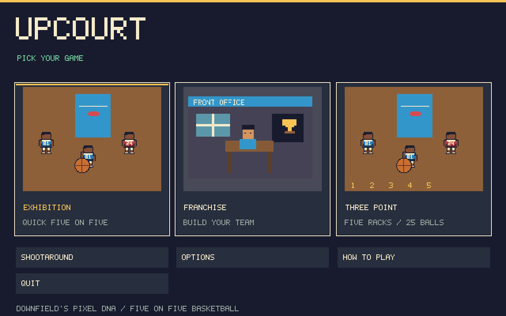
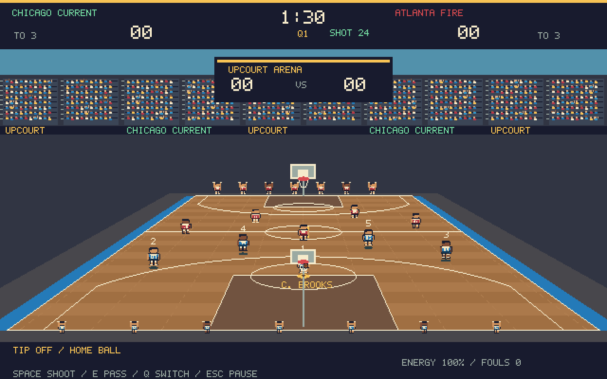
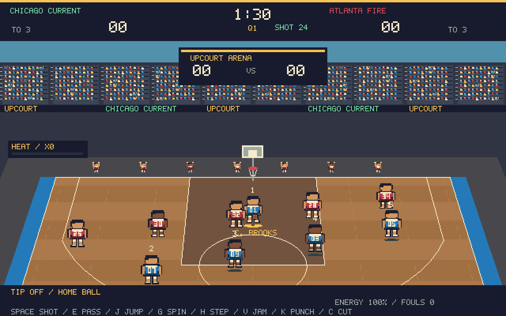
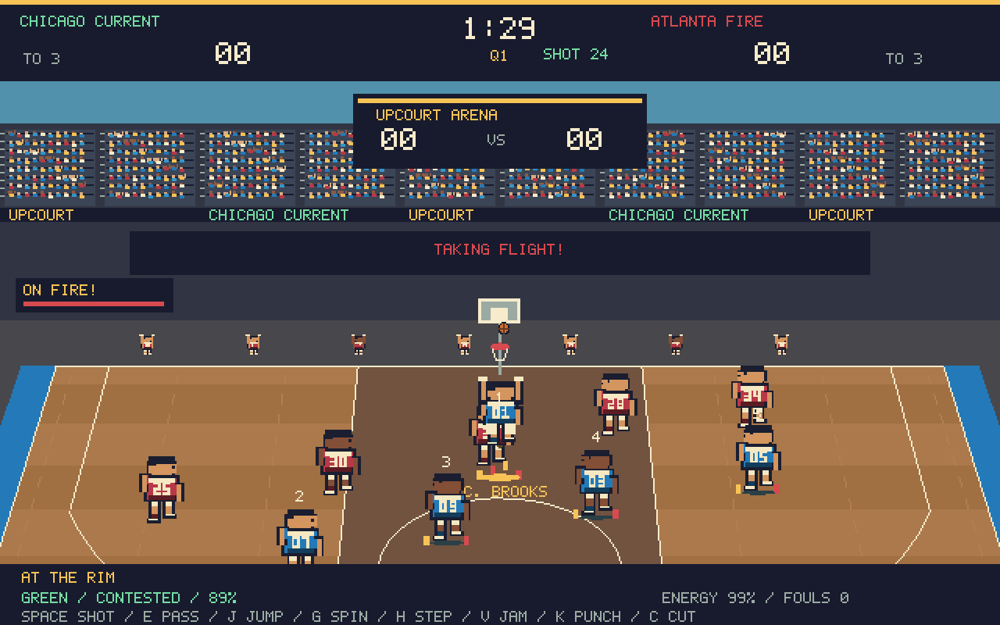
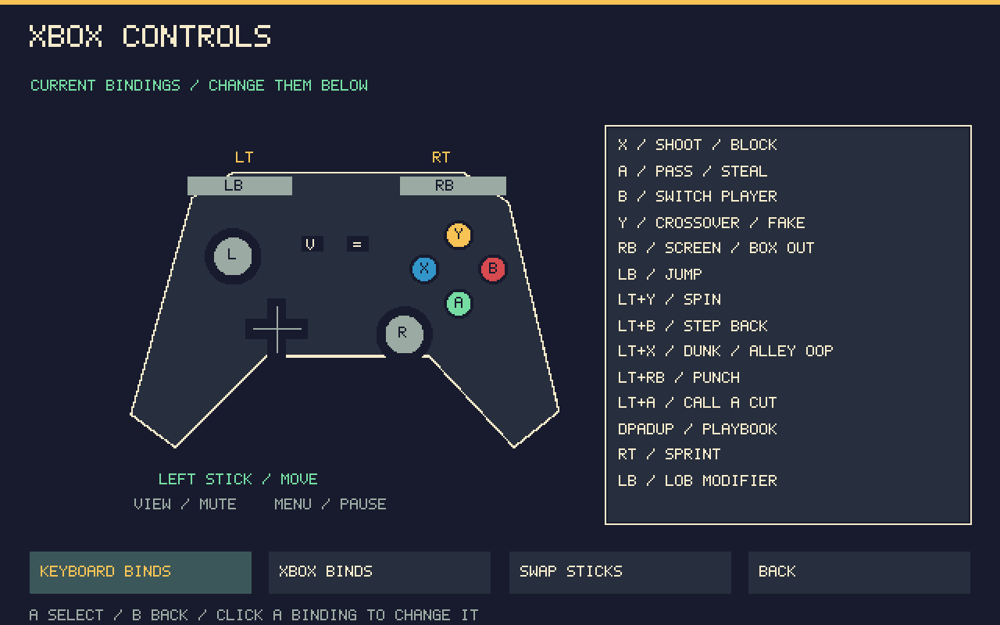

# Upcourt

A native Windows arcade basketball game built from the design of [Downfield](https://github.com/dstaggs-15/downfieldftbl). Quick five-on-five games on the court, a team to build across seasons, and **the same procedural pixel art style**.

Upcourt reuses Downfield's original pixel font, 24×30 player geometry, outline and skin colors, uniform palette, running animation, navy panels, cream lettering, gold highlights, crowd construction and 640×400 nearest-neighbor rendering. Basketball adds bare heads, sleeveless uniforms, hardwood, hoops and ball animation to that foundation.

## Just want to play?

**[Download the Windows installer](https://github.com/dstaggs-15/upcourt/raw/refs/heads/main/play%20me/Install%20Upcourt.exe)**

Open it and click **INSTALL GAME**. It installs the game for your Windows account and creates an Upcourt desktop shortcut. No administrator access or additional game downloads are needed.

Or get the **[portable EXE](https://github.com/dstaggs-15/upcourt/raw/refs/heads/main/play%20me/Upcourt.exe)** or **[Windows ZIP](https://github.com/dstaggs-15/upcourt/raw/refs/heads/main/play%20me/Upcourt-Windows.zip)**. The ZIP includes the game, installer and launcher. Requires **64-bit Windows 10/11 with .NET Framework 4.8**. The executables are unsigned.



## On the court

- A **moving follow camera** tracks the ball up and down the floor, leads fast breaks and moves closer for shots. Players stay large as you reach either basket.
- **Hyper arcade offense:** turbo runs, spin dribbles, step-backs, pump fakes, called cuts, give-and-go runs, power dunks and automatic alley-oop finishes.
- **Jump whenever you want** to clear traffic, attack the rim, win boards or reject a shot. Steals now create a burst of fast-break speed.
- **Punches with referee risk:** land a cartoon hit to knock an opponent down, but a caught punch awards two free throws and possession. Two caught punches eject the offender. Referee position and blocked sightlines affect whether the hit is seen; CPU defenders can occasionally try a cheap shot too.
- **Heat and combos:** steals, blocks, ankle breakers and buckets fill your heat meter. Earn twelve seconds on fire for faster movement and stronger shooting, with flames, impact shake and big-play callouts.
- **Real recorded crowds, matching Downfield:** quiet stadium ambience, cheers, applause and groans, mixed under short dribbles, swishes, rim slams, hits and whistles. The artificial crowd hiss, rising action tones and automatic electronic squeak loop have been removed. Options includes separate volume controls and **Preview Real Crowd**.
- Play **both offense and defense** in five-on-five basketball.
- Hold and release to shoot. A visible meter reports timing, contest level and estimated make probability. Close finishes use an earlier release point.
- Make two-pointers, corner threes and shots from behind the arc. Layups and dunk attempts use finishing skill.
- Pass to an open teammate, use numbered passing icons, or loft a lob. Defenders can intercept passing lanes.
- Call a screen, cross over, pump fake, sprint, switch defenders, reach for a steal, contest and block shots.
- Chase offensive and defensive rebounds. An offensive board gives you 14 seconds.
- Four short quarters, a 24-second shot clock, eight-second backcourt limit, backcourt violations, shooting fouls, free throws, team-foul bonus, six personal fouls, timeouts and overtime.
- Choose man-to-man, 2–3 zone or full-court pressure for your defense.
- Real bench players substitute for tired or foul-troubled starters. Set rotations in your roster, or manage substitutions at a stoppage.
- **24 basketball plays**, including horns, Spain pick-and-roll, floppy, double drag, Princeton cuts, hammer, elevator, triangle and spread isolation.
- Draw five-player routes and save up to **40 custom plays**. Name, edit, delete and use them from the playbook.







## Modes

**Exhibition** starts a quick game with two fictional clubs. **Franchise** follows your coach and club through the league. **Shootaround** removes the game clock so you can practice. **Three Point** gives you 70 seconds, five racks and 25 shots; every fifth ball is worth two, for a perfect 30. Your best contest score is saved.

Exhibition and skills modes do not change franchise standings, cash, player development or career statistics.

## Build your team

The franchise has **12 clubs**, permanent player identities, primary and secondary positions, and independent CPU rosters.

- Play a **22-game home-and-away season**. The top six qualify; the top two receive first-round byes.
- Win best-of-three opening and semifinal series, then a **best-of-five final**.
- Manage a **15-player roster** under a **$140M salary cap**. Set five starters and reserve rotation targets.
- Scout shooting, finishing, passing, handle, speed, defense, rebounding, stamina, potential, age, morale, injuries, salaries and contract years.
- Sign free agents to the bench, renew contracts, buy out reserves or negotiate trades. CPU trade reviews account for value, age, potential, contracts, health, positional depth, team strategy and both payrolls. The deadline starts at round 17.
- Hire offensive, defensive and conditioning coaches. Upgrade training, medical and arena facilities. Training grants XP once per round.
- Follow gate revenue, expenses, cash, fans and owner confidence. Change ticket prices, team colors and mascot, or relocate to an available city.
- Keep your coach's wins, losses and titles when changing clubs. Poor owner confidence can cost you the job after a season.
- Track points, rebounds, assists, steals, blocks, turnovers, fouls, shooting splits and minutes. Follow leaders and archived MVP, defender, rookie and championship awards.
- Age players, expire contracts, retire veterans and complete a **two-round draft** between seasons. CPU clubs also recruit, develop players, trade and improve staff.

The [player and franchise guide](docs/PLAYER-GUIDE.md) explains the rules, economy, draft and saves in detail.

## Controls

| Action | Keyboard | Xbox controller |
|---|---|---|
| Move | WASD | Left stick |
| Sprint | Shift | RT |
| Shoot / free throw | Hold Space, release | Hold X, release |
| Pass / steal on defense | E | A |
| Lob pass | Ctrl + E | LB + A |
| Pass to a position | 1–5 | A chooses a teammate |
| Switch player | Q | B |
| Crossover / pump fake while charging | F | Y |
| Screen / box out | R | RB |
| Block / jump contest on defense | Space | X |
| Jump on either end | J | LB |
| Spin dribble | G | LT + Y |
| Step back | H | LT + B |
| Power dunk / alley-oop pass | V | LT + X |
| Punch | K | LT + RB |
| Call a cut | C | LT + A |
| Playbook | P | Pause → Playbook |
| Timeout | T | Pause → Timeout |
| Pause | Escape | Menu |
| Mute | M | View |
| Fullscreen | F11 | Options menu |

Menus support mouse clicks, arrows/Enter/Escape and D-pad/A/B. Page through long lists with Page Up/Page Down or LB/RB.

Open **Pause → Controls / Xbox Diagram** to see the labeled controller with your current assignments. From there, choose **Keyboard Binds** or **Xbox Binds**. Keyboard keys and Xbox actions can be reassigned; conflicting assignments swap. Xbox capture supports LT/RT combinations, individual triggers, shoulders, face buttons, D-pad and stick clicks. Stick swapping, movement-Y inversion and separate reset-defaults actions are included. Menu navigation stays fixed so a remap cannot trap you in the editor. The diagram and gameplay hints follow your saved bindings.



## Saves

Saves live in `%LOCALAPPDATA%\Upcourt\career.xml`. The game writes atomically and retains `career.xml.bak` for recovery. Live matches save every 15 seconds, on pause-menu **Save and Home**, and when the window closes.

Choose **Resume Match** to continue the exact saved ball flight, clock, roster, fatigue and possession. An unfinished match blocks league transactions and replacement games until you finish or simulate it. A result can count only once.

## Build it yourself

No Unity, Unreal, NuGet packages or JavaScript build step. On Windows, open PowerShell in this repository:

```powershell
.\build.ps1
.\build\Upcourt.exe
```

The script builds the game and a separate test executable, then runs the engine tests. More checks:

```powershell
.\build\Upcourt.Tests.exe --ui-test
.\build-installer.ps1
.\verify-release.ps1
```

The installer build verifies a fresh installation, reinstall and SHA-256 identity of the installed payload. GitHub Actions repeats the Windows build, tests and packaging. See [TESTING.md](docs/TESTING.md).

## Source and analysis

- [Downfield analysis and basketball design mapping](docs/DOWNFIELD-ANALYSIS.md)
- [Source architecture](docs/ARCHITECTURE.md)
- [REA evidence](research/README.md)
- `src/Match.cs`, `Arcade.cs`: live basketball, arcade moves, referee penalties, heat, AI and simulation.
- `src/CourtCamera.cs`: smooth ball tracking, fast-break look-ahead and shot framing.
- `src/League.cs`: rosters, finances, trades, schedule, postseason, career and draft.
- `src/GameForm.cs`, `Rendering.cs`, `PlayDesigner.cs`: pixel menus, arena and route editor.
- `src/PixelArt.cs`: Downfield's font and adapted original player renderer.
- `src/Persistence.cs`, `Input.cs`, `ControlBindings.cs`, `ControlsUI.cs`: saves, keyboard/XInput, remapping and the pause controller diagram.
- `src/Audio.cs`, `CrowdRecordings.cs`, `StadiumMixer.cs`, `ArcadeSounds.cs`, `WaveOutput.cs`: embedded recorded crowds and short court effects using Downfield's native PCM-output approach.

This is an arcade rule set. Court boundaries constrain movement; it does not model every professional rule, a full referee/out-of-bounds system, online multiplayer or local versus play. Match simulation is a separate accelerated possession model. Crowd recordings are CC0; sources and processing are documented in [audio/CREDITS.md](audio/CREDITS.md). Court effects are short synthesized transients. Automated checks cover the implemented flows and verify the actual embedded recording identities; physical controller feel and subjective audio quality still need human playtesting.

Original Downfield code/art attribution and the MIT license are retained in [LICENSE.txt](LICENSE.txt). New basketball code is MIT licensed too.
